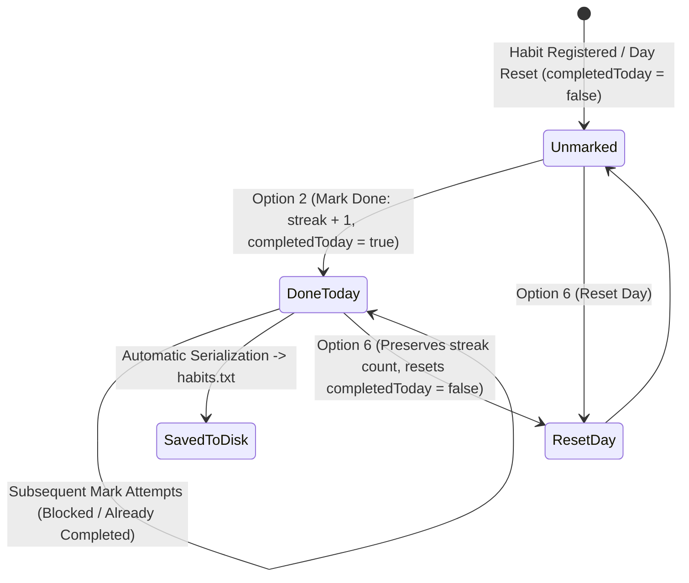

# Habit Tracker (CLI)

[](#technology-stack)
[](#architecture--persistence)
[]()

A lightweight console-based habit tracking utility written in Java that manages recurring habits, tracks completion streaks, and persists data across sessions using flat-file serialization.

---

## Overview

**Habit Tracker** is a command-line interface (CLI) application built using standard Java. It enables users to register custom habits, record daily task completions to maintain active streaks, and persist state locally across terminal sessions without external database dependencies.

---

## Habit Lifecycle & State Machine



---

## Features

- **Habit Lifecycle Management:**
  - Add new named habits with an initial streak of 0.
  - Delete existing habits with list-indexed selection.
  - View all registered habits alongside their current streak counts and today's completion status.
- **Streak Tracking:**
  - Mark habits completed for the current day.
  - Prevents multiple increments on the same day via a `completedToday` flag.
- **Manual Day Reset:**
  - Reset daily status across all tracked habits to start a new day while preserving accumulated streaks.
- **Flat-File State Persistence:**
  - Automatically serializes state to `habits.txt` after every mutation.
  - Loads previously stored habits automatically on startup.

---

## Interactive Menu

When launched, the program presents a numeric menu:

```text
--- Habit Tracker ---
1. Add Habit
2. Mark Habit as Done
3. View Habits
4. Exit
5. Delete Habit
6. Reset Day (all habits)
```

### Sample Session Output

```text
1. Read Technical Docs | Streak: 7 | Done Today: Yes
2. Morning Run         | Streak: 3 | Done Today: No
3. Practice LeetCode   | Streak: 12| Done Today: Yes
```

---

## Architecture & Persistence

The application relies solely on standard Java libraries (`java.util.*`, `java.io.*`):

- **`Habit` Class:** Models each habit entity with `name` (String), `streak` (int), and `completedToday` (boolean). Contains business logic to increment streaks once per daily cycle.
- **`HabitTracker` Class:** Drives the CLI execution loop, handles user input via `java.util.Scanner`, and coordinates file I/O.
- **Persistence (`habits.txt`):** Habits are stored in a comma-delimited flat-file format:
  ```text
  Read Technical Docs,7,true
  Morning Run,3,false
  Practice LeetCode,12,true
  ```

---

## Getting Started

### Prerequisites

- Java Development Kit (JDK 8 or higher) installed. Verify with:
  ```bash
  java -version
  ```

### Compilation & Execution

1. **Clone the repository:**
   ```bash
   git clone https://github.com/Kartik-idk/Habit-Tracker.git
   cd Habit-Tracker
   ```

2. **Compile the source:**
   ```bash
   javac HabitTracker.java
   ```

3. **Run the application:**
   ```bash
   java HabitTracker
   ```

---

## Engineering Highlights & Design Trade-offs

- **Zero External Dependencies:** Built entirely with core Java SE standard libraries with zero external frameworks.
- **Trade-offs & Known Limitations:**
  - **Flat-File Parsing:** The storage uses a simple delimiter (`,`); habit names containing commas will disrupt parsing.
  - **Day Transition:** Resetting completion for a new day is handled via the manual menu option (option 6) rather than automated calendar dates or background cron daemons.
  - **Concurrency:** Designed for single-user interactive terminal sessions without file-locking mechanisms.

---

## License & Permissions

Open source educational software created by [Kartik-idk](https://github.com/Kartik-idk).
